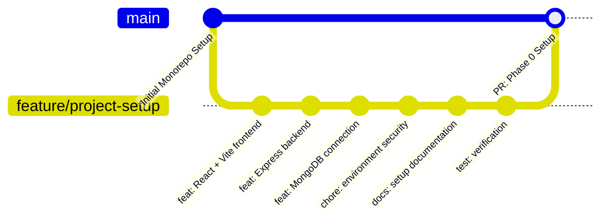

# Hostel and PG Finder

[](https://opensource.org/licenses/ISC)
[](https://nodejs.org/)
[](https://react.dev/)
[](https://expressjs.com/)
[](https://tailwindcss.com/)
[](https://mongoosejs.com/)

A modern, full-stack **MERN** web platform designed to streamline accommodation discovery, booking, and management for students, working professionals, and hostel/PG owners.

---

## Table of Contents

- [1. Project Introduction](#1-project-introduction)
- [2. Problem Statement](#2-problem-statement)
- [3. Project Objectives](#3-project-objectives)
- [4. Technology Stack](#4-technology-stack)
- [5. Architecture Overview](#5-architecture-overview)
- [6. Folder Structure](#6-folder-structure)
- [7. Installation Instructions](#7-installation-instructions)
- [8. Environment Configuration](#8-environment-configuration)
- [9. Frontend Startup Instructions](#9-frontend-startup-instructions)
- [10. Backend Startup Instructions](#10-backend-startup-instructions)
- [11. API Health-Check Instructions](#11-api-health-check-instructions)
- [12. Git Branching Strategy](#12-git-branching-strategy)
- [13. Upcoming Implementation Phases](#13-upcoming-implementation-phases)

---

## 1. Project Introduction

**Hostel and PG Finder** is a centralized, digital marketplace bridging the gap between accommodation seekers (students and working professionals) and property owners (hostels and paying guest accommodations). The platform provides transparent pricing, verified amenities, high-resolution imagery, location-based mapping, and seamless inquiry workflows.

---

## 2. Problem Statement

Finding reliable and affordable hostel or PG accommodation in urban areas and university hubs poses major challenges:
- **Fragmented Information**: Students often rely on outdated word-of-mouth recommendations, roadside posters, or unauthorized intermediaries.
- **Lack of Transparency**: Hidden charges, misleading photos, unverified security conditions, and absent refund policies.
- **Inefficient Communication**: Manual telephone calls and physical visits are time-consuming and inconvenient for both tenants and owners.
- **Administrative Burden**: PG owners lack centralized management software to handle inquiries, occupancy rates, and tenant records.

---

## 3. Project Objectives

- **Centralized Platform**: Provide a unified platform where accommodation seekers can discover, compare, and connect with verified hostels and PGs.
- **Modern User Experience**: Deliver a responsive, mobile-first interface optimized for speed and clarity.
- **Secure Architecture**: Enforce robust authentication, input validation, rate limiting, and role-based access control.
- **Scalable Monorepo**: Maintain clean separation between the React client and Express API to facilitate modular deployment and testing.
- **Resilient Infrastructure**: Design failure-tolerant database connections and centralized error handling.

---

## 4. Technology Stack

### Frontend Tier
- **Library**: [React.js 18](https://react.dev/)
- **Bundler & Dev Server**: [Vite 6](https://vitejs.dev/)
- **Styling**: [Tailwind CSS 3.4](https://tailwindcss.com/)
- **Icons**: [Lucide React](https://lucide.dev/)
- **HTTP Client**: [Axios 1.7](https://axios-http.com/)

### Backend Tier
- **Runtime**: [Node.js](https://nodejs.org/) (v18+)
- **Web Framework**: [Express.js 4.21](https://expressjs.com/)
- **Security Middleware**: [Helmet](https://helmetjs.github.io/)
- **CORS Handler**: [cors](https://www.npmjs.com/package/cors)
- **HTTP Request Logger**: [Morgan](https://www.npmjs.com/package/morgan)
- **Configuration**: [dotenv](https://www.npmjs.com/package/dotenv)

### Database Tier
- **Database**: [MongoDB](https://www.mongodb.com/)
- **Object Data Modeling (ODM)**: [Mongoose 8](https://mongoosejs.com/)

### Tooling & DevOps
- **Concurrency**: [concurrently](https://www.npmjs.com/package/concurrently)
- **Integration Testing**: [Supertest](https://www.npmjs.com/package/supertest) with Node.js native test runner
- **Version Control**: Git & GitHub

---

## 5. Architecture Overview

The system employs a decoupled, client-server REST architecture:

```
+-----------------------------------------------------------+
|                   Browser / Client Tier                   |
|  React 18 SPA (Vite) + Tailwind CSS + Axios Client        |
|  Port: 5173                                               |
+-----------------------------+-----------------------------+
                              |
                     HTTP / JSON (REST)
                              |
+-----------------------------v-----------------------------+
|                   Express API Server                      |
|  Helmet + CORS + Morgan + Body Parsers + Error Handlers   |
|  Port: 5000                                               |
+-----------------------------+-----------------------------+
                              |
                    Mongoose Connection
                              |
+-----------------------------v-----------------------------+
|                     Data Tier                             |
|  MongoDB Database (Local or MongoDB Atlas)                |
|  Default URI: mongodb://127.0.0.1:27017/hostel_pg_finder   |
+-----------------------------------------------------------+
```

Detailed architecture specifications and sequence flows are documented in [`docs/architecture.md`](docs/architecture.md).

---

## 6. Folder Structure

```
Hostel-and-PG-finder/
├── client/                     # Frontend Single Page Application
│   ├── public/                 # Static public assets
│   │   └── vite.svg
│   ├── src/                    # Application source code
│   │   ├── assets/             # Images, graphics, and static media
│   │   ├── components/         # Reusable UI components
│   │   │   ├── Footer.jsx
│   │   │   ├── Header.jsx
│   │   │   ├── HealthStatusCard.jsx
│   │   │   ├── PhaseRoadmapCard.jsx
│   │   │   └── TechStackGrid.jsx
│   │   ├── hooks/              # Custom React hooks
│   │   │   └── useHealthCheck.js
│   │   ├── layouts/            # Page layouts
│   │   │   └── MainLayout.jsx
│   │   ├── pages/              # View pages
│   │   │   └── LandingPage.jsx
│   │   ├── services/           # API and Axios services
│   │   │   ├── api.js
│   │   │   └── healthService.js
│   │   ├── utils/              # Frontend utilities and constants
│   │   │   └── constants.js
│   │   ├── App.jsx             # Root React component
│   │   ├── index.css           # Tailwind base, components, utilities
│   │   └── main.jsx            # Application DOM entry point
│   ├── .env.example            # Client environment template
│   ├── index.html              # HTML entry template
│   ├── package.json            # Client dependencies and scripts
│   ├── postcss.config.js       # PostCSS configuration
│   ├── tailwind.config.js      # Tailwind CSS configuration
│   └── vite.config.js          # Vite build configuration
│
├── server/                     # Backend RESTful API
│   ├── src/                    # Backend source code
│   │   ├── config/             # Database and server configuration
│   │   │   └── db.js           # Reusable MongoDB Mongoose connector
│   │   ├── controllers/        # Route controllers
│   │   │   └── healthController.js
│   │   ├── middleware/         # Custom Express middlewares
│   │   │   ├── errorHandler.js # Centralized error handler
│   │   │   └── notFoundHandler.js # 404 handler
│   │   ├── models/             # Mongoose schemas & models (Phase 1+)
│   │   ├── routes/             # Express API routes
│   │   │   ├── healthRoutes.js
│   │   │   └── index.js        # Root API router
│   │   ├── services/           # Backend business logic services
│   │   ├── utils/              # Utility helpers
│   │   │   └── envValidate.js  # Environment validation
│   │   ├── app.js              # Express app setup and middleware configuration
│   │   └── server.js           # HTTP server startup & graceful shutdown
│   ├── tests/                  # Integration tests
│   │   └── health.test.js      # Automated health-check test
│   ├── .env.example            # Server environment template
│   └── package.json            # Server dependencies and scripts
│
├── docs/                       # Project documentation
│   ├── architecture.md         # System architecture specification
│   ├── development-setup.md    # Local setup and developer guide
│   └── reports/                # Phase completion reports
│       └── PHASE_0_REPORT.md
│
├── .gitignore                  # Git ignore rules for monorepo
├── package.json                # Root monorepo scripts & dev dependencies
└── README.md                   # Master project documentation
```

---

## 7. Installation Instructions

1. **Clone the repository:**
   ```bash
   git clone https://github.com/purush777196/Hostel-and-PG-finder.git
   cd Hostel-and-PG-finder
   ```

2. **Switch to the feature branch:**
   ```bash
   git checkout feature/project-setup
   ```

3. **Install all dependencies across root, server, and client:**
   ```bash
   npm run install:all
   ```

---

## 8. Environment Configuration

### Server Configuration
Create `server/.env` based on `server/.env.example`:
```bash
cp server/.env.example server/.env
```

Default values in `server/.env`:
```env
PORT=5000
NODE_ENV=development
MONGODB_URI=mongodb://127.0.0.1:27017/hostel_pg_finder
CLIENT_URL=http://localhost:5173
```

### Client Configuration
Create `client/.env` based on `client/.env.example`:
```bash
cp client/.env.example client/.env
```

Default values in `client/.env`:
```env
VITE_API_BASE_URL=http://localhost:5000/api
```

---

## 9. Frontend Startup Instructions

Start the Vite development server:

```bash
# From the root directory:
npm run client

# Or directly from client/:
cd client
npm run dev
```

The frontend application will be live at: **`http://localhost:5173`**

---

## 10. Backend Startup Instructions

Start the Express development server:

```bash
# From the root directory:
npm run server

# Or directly from server/:
cd server
npm run dev
```

The backend API will be live at: **`http://localhost:5000`**

### Concurrent Startup (Recommended)
To run both client and server together with synchronized logging:
```bash
npm run dev
```

---

## 11. API Health-Check Instructions

Verify the backend service is running and healthy:

### Using curl:
```bash
curl http://localhost:5000/api/health
```

### Expected Response (`HTTP 200 OK`):
```json
{
  "success": true,
  "message": "Hostel and PG Finder API is running"
}
```

### Automated Health Test:
Run the automated test suite:
```bash
npm run test:server
```

---

## 12. Git Branching Strategy

The repository follows a feature branch workflow:

- **`main`**: Production-ready, stable releases. Protected from direct pushes.
- **`feature/*`**: Feature branches for specific development phases (e.g., `feature/project-setup`, `feature/auth`, `feature/listings`).
- **Pull Requests (PR)**: All code merged into `main` requires peer review and passing automated tests.



---

## 13. Upcoming Implementation Phases

| Phase | Milestone | Description |
| :---: | :--- | :--- |
| **Phase 0** | **Repository Initialization & Architecture Setup** | **Current Phase** - Monorepo structure, React/Vite, Express, MongoDB connector, health check. |
| **Phase 1** | **Authentication & Authorization** | User registration/login, JWT tokens, bcrypt password hashing, role-based access control. |
| **Phase 2** | **Hostel & PG Listing Management** | Accommodation schemas, CRUD APIs, image uploads, amenities tagging, owner dashboard. |
| **Phase 3** | **Search, Filter & Discovery** | Location search, pricing filters, gender preferences (Boys/Girls/Co-ed), map integration. |
| **Phase 4** | **Booking & Inquiry Engine** | Room reservations, schedule visit requests, owner messaging system. |
| **Phase 5** | **Reviews, Ratings & Deployment** | User feedback, ratings, production Docker containerization, CI/CD pipeline. |

---

## License

This project is licensed under the [ISC License](LICENSE).

