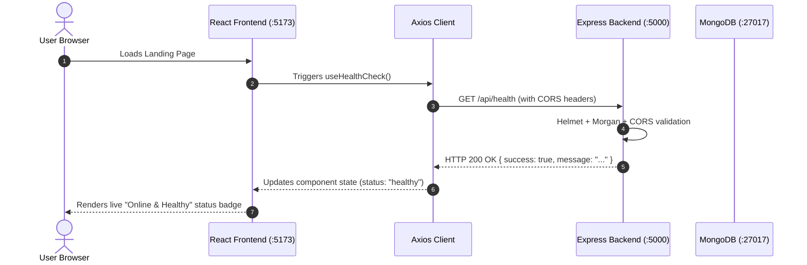

# Architecture Documentation: Hostel and PG Finder

## 1. System Overview

**Hostel and PG Finder** is built on the industry-standard **MERN** architecture (MongoDB, Express.js, React, Node.js). The application follows a decoupled client-server architecture where the frontend Single Page Application (SPA) communicates with the backend RESTful API over HTTP using JSON payloads.

```mermaid
graph TD
    User["Web Client / Browser"]
    subgraph Frontend ["Client Tier (Vite + React)"]
        UI["React 18 UI Components"]
        Hooks["Custom Hooks (useHealthCheck)"]
        Services["API Service Layer (Axios)"]
    end
    subgraph Backend ["Server Tier (Node.js + Express)"]
        Middleware["Security & Middleware (Helmet, CORS, Morgan)"]
        Router["Express Routers (/api/*)"]
        Controllers["Controllers (healthController)"]
        ErrorHandler["Centralized Error Handler"]
    end
    subgraph DatabaseTier ["Data Tier (MongoDB)"]
        ODM["Mongoose ODM"]
        MongoDB[("MongoDB Database")]
    end

    User -->|User Interaction| UI
    UI --> Hooks
    Hooks --> Services
    Services -->|HTTP / JSON (REST)| Middleware
    Middleware --> Router
    Router --> Controllers
    Controllers -.->|Mongoose Queries| ODM
    ODM -.->|TCP Wire Protocol| MongoDB
    Controllers -->|JSON Response| Services
    Controllers -.->|Exceptions| ErrorHandler
    ErrorHandler -->|Standardized Error Response| Services
```

---

## 2. Frontend Architecture (`/client`)

The frontend is bootstrapped using **Vite** with **React 18** and styled using **Tailwind CSS**.

### Key Characteristics
- **Fast Development & Production Builds**: Vite provides instant hot module replacement (HMR) and optimized Rollup-based production bundles.
- **Layered Component Architecture**:
  - `components/`: Modular, reusable UI components (Header, Footer, HealthStatusCard, TechStackGrid, PhaseRoadmapCard).
  - `layouts/`: Master page layout templates (`MainLayout.jsx`).
  - `pages/`: Page-level route views (`LandingPage.jsx`).
  - `services/`: Axios HTTP instance and resource-specific service functions (`api.js`, `healthService.js`).
  - `hooks/`: Reusable React hooks encapsulating asynchronous state logic (`useHealthCheck.js`).
  - `utils/`: Shared frontend constants and configuration mappings.
- **Environment Isolation**: API base URL is resolved at build/runtime via `import.meta.env.VITE_API_BASE_URL` with a sensible local fallback.
- **Responsive Design**: Mobile-first responsive layouts implemented via Tailwind CSS utility classes.

---

## 3. Backend Architecture (`/server`)

The backend is built with **Node.js** and **Express.js**, designed around strict separation of concerns.

### Architectural Highlights
- **Separation of App vs. Server**:
  - `src/app.js`: Configures middleware, API routes, 404 handlers, and centralized error handling. It exports the configured Express app instance without binding to a network port. This enables seamless integration testing with `supertest` without port collisions.
  - `src/server.js`: Handles environment validation, initiates the non-blocking MongoDB connection, binds `app` to the specified HTTP port, and manages graceful process termination (`SIGTERM`, `SIGINT`).
- **Middleware Pipeline**:
  1. `helmet()`: Implements HTTP security response headers.
  2. `cors()`: Configures cross-origin access control, permitting requests from the React client.
  3. `morgan()`: Logs incoming HTTP requests (`dev` format in development, `combined` in production).
  4. `express.json()` and `express.urlencoded()`: Parses incoming request bodies.
  5. `notFoundHandler`: Catches unhandled routes and returns standard 404 JSON.
  6. `errorHandler`: Centralized error middleware returning normalized `{ success: false, message: ... }` responses.
- **Route & Controller Separation**:
  - `src/routes/`: Declarative route definitions mapping URI patterns to controller handlers.
  - `src/controllers/`: Business logic handlers parsing input and generating HTTP responses.

---

## 4. Database Architecture (`MongoDB & Mongoose`)

- **ODM Layer**: **Mongoose** is used for object modeling, schema validation, and database operations.
- **Resilient Connection Module (`src/config/db.js`)**:
  - Reads `MONGODB_URI` from environment variables.
  - Never hardcodes database credentials.
  - Implements a 5-second `serverSelectionTimeoutMS` to prevent server hanging when the database is unavailable.
  - Non-blocking: Server continues serving health and stateless endpoints even if MongoDB is temporarily down or unconfigured.
  - Graceful disconnection on application termination.

---

## 5. Communication & Security Flow



### Security Measures in Phase 0:
- **CORS Protection**: Access restricted to trusted client origins.
- **Helmet Security Headers**: Protection against XSS, clickjacking, and MIME-sniffing.
- **Environment Isolation**: `.env` files strictly gitignored; configuration supplied via `.env.example` templates.
- **Zero Hardcoded Secrets**: MongoDB connection strings and port configurations are externalized.

